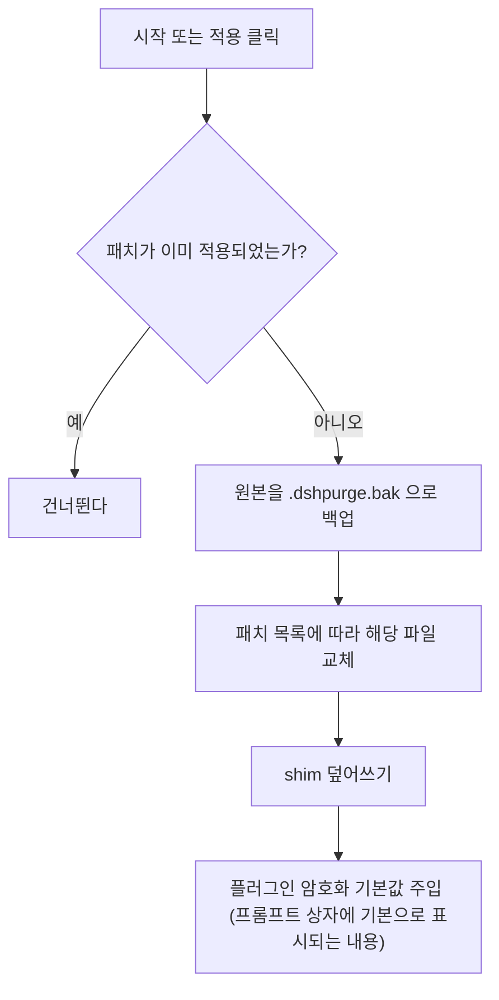
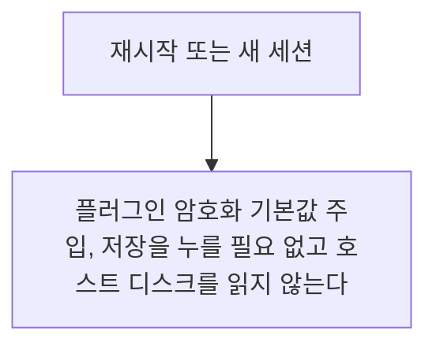
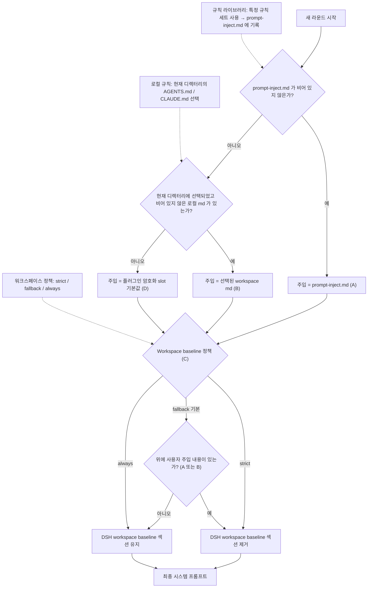
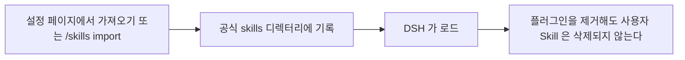

> 아카이브 스냅샷: 원 업스트림 저장소 `YuJunZhiXue/dsh-purge` 는 더 이상 접근할 수 없다. 이 문서의 업스트림 링크는 기록용이며 클릭하면 404 가 날 수 있다.

<p align="center">
  
</p>

<h1 align="center">⚔️ DeepSeek Harness 사이버 보안 레드팀 도구(dsh-purge)</h1>

<p align="center"><strong>Version 1.1.71</strong></p>

<p align="center">
  <em>DeepSeek Harness 탈옥: 모든 모델을 탈옥시킬 수 있고, 모델마다 다른 프롬프트를 쓸 수 있다. 기본 프롬프트는 중국 국산 모델 'Little Code Sauce'를 대상으로 한다. Jailbreak for every model — swap prompts per model. Star ⭐ 를 눌러 즐겨찾기해 주면 좋다. 2차 개발을 하려면 저작자 표시 요구 사항 절을 확인한다</em>
</p>

<p align="center">
  <a href="https://github.com/YuJunZhiXue/dsh-purge/stargazers"></a>
  <a href="https://github.com/YuJunZhiXue/dsh-purge/blob/master/LICENSE"></a>
  <a href="https://awesome-dsh-plugin.com"></a>
  <a href="https://deepseek.stream/plugins/dsh-purge"></a>
  <a href="https://www.deepseek.com/harness/"></a>
  <br>
  
  
</p>

<p align="center">
  <a href="https://dsh-plugin.org/plugins/yujunzhixue/dsh-purge"></a>
</p>

<p align="center">
  <a href="README.md">English</a> | <a href="README.ko-KR.md">한국어</a>
</p>

> **업데이트 중지.** 작성자는 업무 일정 때문에 당분간 안정적인 수입이 없어 프로젝트 유지보수를 잠시 보류한다: 더 이상 릴리스하지 않고, issue / PR 도 당분간 받지 않으며, 새 dsh 버전 대응도 보장하지 않는다. 저장소는 계속 개인 용도로 쓸 수 있다. 후원은 아래를 본다. 유지보수를 재개하면 이 README 에 밝힌다.

> **공식 Web 과 공식 데스크톱 모두 지원한다.** 공식 `dsh web` 은 profile `web` 을 쓴다. 공식 데스크톱 EXE(DeepSeek Harness **0.2.0-rc.2**)는 profile `desktop` 을 쓴다. 양쪽은 따로 설치하고 따로 '적용'을 누른다. 현재 버전은 dsh 0.2 에만 대응한다. 더 이른 dsh 는 그에 맞는 구버전 플러그인을 쓴다. 커뮤니티 데스크톱은 유지보수하지 않는다.
>
> profile 에 넣는 것만으로는 호스트가 바뀌지 않는다. 세션 제목 옆 **dsh-purge** → **정리** → **적용** 을 누른다. 성공하면 자동으로 재시작하고, 패치가 다 끝나지 않았으면 재시작하지 않는다. 재시작 후 새 대화를 열어야 주입이 현재 세션에 들어간다.
>
> Node.js **≥18**. Windows 에서 콘솔 창 없이 실행하려면 **Node ≥22** 가 필요하다. 플러그인 마켓 원클릭 설치와 아래 명령은 모두 npm 패키지 `dsh-purge` 를 쓴다.

## 목차

- [후원](#sponsor)
- [소개](#소개)
- [저작자 표시 요구 사항](#저작자-표시-요구-사항)
- [위반 상업 이용 공개](#위반-상업-이용-공개)
- [지원 범위](#지원-범위)
- [설치](#설치)
- [화면](#화면-미리보기)
- [사용법](#사용법)
- [내 서버](#내-서버)
- [동작 원리](#동작-원리)
- [되돌리기](#되돌리기)
- [업데이트](#업데이트)

---

<a id="sponsor"></a>

## ☕ 후원

이 프로젝트가 도움이 되었다면 후원을 환영한다. 나는 동냥쟁이니 조금만 나눠 달라~


| 자산          | 주소                                             |
| ----------- | ---------------------------------------------- |
| USDT(TRC20) | `TV5ajPkRD8RH623Dx9mqvYZVNN8nPGRKid`           |
| Solana      | `6x16GhRgLVpKFFXaU1seKNdx2rypspSJTL4dbpt6Xpwk` |
| Ethereum    | `0xB68BD60C0e8c519513B7DF9bB147696815423B3E`   |
| Bitcoin     | `bc1qu70yxkrtwnymt8ryluz9x8y8hqzune5340npht`   |


---

## 소개

**dsh-purge** 는 사용자 본인의 공식 [DeepSeek Harness](https://www.deepseek.com/harness/) 에 설치하는 네트워크 보안 레드팀 평가 플러그인이다. 공식 **Web**(`dsh web`)과 공식 **데스크톱**(EXE)을 모두 지원하며, 양쪽은 따로 설치하고 따로 적용한다.

Harness 는 질문을 모델에 넘기는 것만 하지 않는다. 실행 중에 프롬프트, 승인 게이트, 샌드박스, 세션 형식까지 바꾼다. '모델이 답하느냐'만 보면 호스트의 차단을 모델의 거부로 잘못 판정한다. 이 플러그인은 사용자 자신의 설치에서 이 두 계층을 분리해, 통제된 평가에 쓰고 기본 정책을 더 조여야 하는지도 판단한다.


| 사용하는 것             | 하는 일                                            |
| ---------------- | ----------------------------------------------- |
| **dsh-purge 사이드바** | 세션 제목 옆 버튼으로 오른쪽 사이드바를 연다. 안에 두 페이지가 있다: 정리, 드릴 콘솔                       |
| **정리**           | 패치를 그룹별로 보고 적용·되돌리기·제거한다. 프롬프트와 여러 규칙 세트를 편집한다                      |
| **드릴 콘솔**          | 정식 버전에 내장된다. 승인 후 자산, 스킬, 본인 환경을 조회한다. 사용자가 관리 권한을 가진 본인 환경, 오프라인 실습 환경, 서면 승인을 받은 드릴에만 쓴다 |
| **호스트 정책**         | 기본 문구, 권한 정책, 도구 상한을 조정한다. 공식 기능은 그대로 두고 별도 정체성을 새로 쓰지 않는다                 |
| **시작 시**          | 자동으로 다시 점검하고 적용한다. npm 업그레이드가 `node_modules` 를 덮은 뒤에도 파일을 직접 고칠 필요가 없다       |


드라이브 문자를 고정하지 않는다. `$DSH_HOME`, dsh 런처 옆의 `.dsh`, 마지막으로 `~/.dsh` 순으로 찾는다. Harness 소스 저장소는 건드리지 않는다. **dsh-purge** 의 '정리'에서 '적용'을 눌러야 기록된다. 정체성은 플러그인 안의 암호화된 프롬프트, 즉 프롬프트 상자가 기본으로 보여주는 그 본문에서 온다. 호스트 디스크의 프롬프트 파일은 읽지 않는다.

이 플러그인은 사용자 본인 환경에 설치된 공식 `@deepseek-ai` 패키지와 본인 환경 설정만 다룬다. 공인망 스캐너가 아니고, 제3자 사이트를 겨냥한 공격 세트도 아니다. 저장소에는 트로이 목마, 미승인 침투 스크립트, 대외 공격 페이로드가 들어 있지 않다.

---

## 📌 비영리 공익 프로젝트이며, 어떤 주체도 상업적 판매, 유료 되팔이, 회색·검은 시장 수익에 사용하는 것을 엄격히 금한다. 기술 참고용으로만 제공한다.

## 저작자 표시 요구 사항

**이 프로젝트의 이름, 아이디어, 코드, 프롬프트를 차용할 때는 반드시 저작자를 표시하고 출처 저장소를 명시해야 한다:** [YuJunZhiXue/dsh-purge](https://github.com/YuJunZhiXue/dsh-purge).

저작자를 표시하지 않거나, 출처를 숨기거나, 이름만 바꿔 자기 것으로 만드는 경우 작성자는 법적 책임을 묻는다.

---

## 위반 상업 이용 공개

Douyin 라이브 계정 **"Lao Zhang's AI"**(방송 화면 표시 **"Lao Zhang AI Classroom"**)가 이 저장소를 유료 상품처럼 팔았다: 방송에서 가격을 묻고 그 자리에서 돈을 받았으며, 저작자를 표시하지도 않고 위의 비영리 조항도 지키지 않았다. 작성자가 그 자리에 있었는데도 상대는 그대로 받았다.

이 프로젝트는 무료·비영리다. 이걸로 강의를 팔거나, 플러그인을 팔거나, 토큰을 팔거나, 되팔면 라이선스는 그 자리에서 무효가 되고 작성자는 책임을 물을 권리를 보유한다.

2026-10-12 라이브 기록:

<p align="center"><em>라이브 화면 캡처는 제거했다(제3자 계정 정보 포함).</em></p>

상대의 WeChat 이름은 **"Lao Zhang AI Tech"** 이고, 라이브 시청자 목록에도 같은 이름이 올라 있었다. 이 저장소 개발자냐고 묻자 스스로 "엄청 대단하다"고 했고, 작성자는 그 자리에서 신고하겠다고 밝혔다.

<p align="center"><em>WeChat 대화 캡처는 제거했다(제3자 사생활 포함).</em></p>

---

### ⚠️ 엄정한 법적 면책 및 규정 준수 사용 선언


**면책 조항:** 이 프로젝트는 비영리 오픈소스 프로젝트이며, 국가 법률·규정과 소재 플랫폼의 관련 규범을 준수하고 학습과 연구 용도로만 제공한다. 이 프로젝트를 어떤 위법·규정 위반 용도로도 사용해서는 안 되며, 그로 인해 발생하는 결과는 사용자가 스스로 부담한다.

**[무관용 엄정 성명]**: 이 프로젝트는 모든 형태의 위법·범죄 행위를 단호히 반대하고 엄격히 금한다. 이 프로젝트 개발자는 미승인 네트워크 공격, 취약점 악용, 데이터 탈취, 컴퓨터 정보 시스템 불법 침입, 위법·금지 콘텐츠 생성 활동을 지지·조장·지원하지 않는다. **이 프로젝트를 위법·범죄에 사용한 모든 행위는 개발자와 무관하며, 행위자가 법에 따라 독립적으로 모든 법적 책임을 진다.**

1. **이 저장소에는 위법 콘텐츠가 없다**: `dsh-purge` 가 배포하는 코드, 문서, 패치, 기본 프롬프트는 트로이 목마, 백도어, 미승인 침투 도구, 랜섬웨어, 크리덴셜 스터핑 스크립트가 **아니며**, 공인망이나 제3자 시스템을 겨냥한 공격 페이로드도 **아니다**. 프로젝트 자체는 위법 콘텐츠를 제공하지 않고, 위법·범죄 실행을 교사·조직·지원하지 않는다.
2. **본인 환경의 공식 Harness 에만 작용한다**: 보안 평가 패치와 프롬프트 주입은 전부 사용자 **본인 환경에 설치된 공식 DeepSeek Harness**(`@deepseek-ai` 패키지, 본인 profile / `$DSH_HOME`)에서만 일어난다. 대상은 사용자 자신의 공식 로컬 소프트웨어이며, 타인의 웹사이트·서버·계정·정보 시스템이 **아니다**.
3. **평가 패치는 외부망 대상에 접속하지 않는다**: 패치 적용, 주입 기록, 롤백, 제거는 모두 본인 환경의 파일과 프로세스 안에서 끝나며, **어떤 공인망 호스트나 미승인 시스템에 대해서도 스캔, 탐지, 침입, 공격 패킷 전송을 하지 않는다**. 이 프로젝트를 외부망 공격의 발판으로 써서는 안 된다. 플러그인에서 '업데이트 확인'을 켜면 버전 대조를 위해 이 플러그인 자신의 GitHub 저장소에만 접속할 수 있으며, **제3자 시스템에 대한 네트워크 공격과 무관하고**, 대외 침투 승인으로 해석될 수도 없다.
4. **합법적 통제 범위 한정**: 이 프로젝트는 사용자가 **자신이 관리 권한을 가진 본인 환경의 공식 Harness** 에서 레드팀 연구와 견고성 평가를 하는 보조 도구로 자리매김한다. **소유자의 합법적 서면 승인이 없는 대상, 공인망 온라인 시스템, 운영 중인 서비스에서 이 프로젝트를 실행하는 것을 엄격히 금한다**. 모든 테스트는 **본인 환경에 승인되어 설치된 공식 Harness, 오프라인 로컬 합성 실습 대상, 승인된 네트워크 보안 드릴 실습 환경, 규정을 지키는 실험실의 통제 환경** 안에서만 해야 한다.
5. **중국 본토, 홍콩, 마카오의 서버와 웹사이트는 금지한다.** 중국 본토, 홍콩, 마카오 대역과 그 대역으로 해석되는 서버·웹사이트·주소에 대해 접속, 스캔, 탐지, 그 밖의 어떤 작업도 해서는 안 된다. 클라우드 사업자 이름은 예외가 되지 않는다. 유일한 예외는 사용자가 사전에 자기 서버로 등록한 바로 그 IP 하나, 또는 그 전체 호스트 이름 하나다. 키, 비밀번호, 대역, 와일드카드, 대화 중의 구두 설명은 모두 예외를 늘리지 못한다. 등록되지 않은 대상은 일괄 금지한다.
6. **위법·금지 용도 엄금**: 사용자는 이 프로젝트를 직간접으로 이용해 다음 법률·규정을 위반하는 어떤 행위도 해서는 안 된다(각 항목을 반드시 지켜야 하며, 어떤 이유로도 회피할 수 없다):
  - **중화인민공화국 형법**
  - **중화인민공화국 네트워크안전법**
  - **중화인민공화국 데이터안전법**
  - **중화인민공화국 개인정보보호법**
  - 그 밖에 현행 효력이 있는 법률, 행정 법규, 감독 규정;
  - 동시에 다음을 엄금한다:
  - 공공·민간 기관의 컴퓨터 정보 시스템에 미승인 침투·공격을 하거나, 랜섬·파괴·크리덴셜 스터핑을 하거나 악성 페이로드를 유포하는 행위;
  - 국가 안보를 해치는 내용, 테러리즘, 폭력·유혈, 음란·도박, 사기, 시민 사생활 또는 지식재산권 침해 등 법이 명시적으로 금지한 위법·금지 콘텐츠를 유도·생성·유포하는 행위;
  - 관련 대규모 언어 모델 제공자의 서비스 약관과 남용 정책을 위반하는 행위.
7. **사용자가 전적으로 책임을 진다**: 이 프로젝트는 MIT 오픈소스 라이선스에 따라 "있는 그대로" 제공되며, 개발자는 소프트웨어의 완전성, 안전성, 적합성에 대해 명시적이든 묵시적이든 어떤 보증도 하지 않는다. **사용자는 자신의 모든 다운로드, 배포, 실행, 수정, 유포 행위와 그로 인해 발생하는 모든 입력·출력 결과에 대해 독립적이고 완전한 민사·행정·형사 법적 책임을 진다**. 프로젝트 작성자와 기여 팀은 사용자의 남용으로 인한 직접·간접·연대 책임을 지지 않는다.
8. **위반 시 즉시 라이선스 종료**: 이 프로젝트를 불법 공격, 악성 활동, 규정 위반에 사용한 개인이나 법인은 그 위법 행위가 발생한 날부터 오픈소스 소프트웨어 사용 라이선스가 **자동으로 그리고 취소 불가능하게 즉시 종료된다**. 해당 주체는 즉시 사용을 중단하고 이 프로젝트의 모든 코드, 스크립트, 파생 데이터를 영구히 파기해야 하며, 법에 따라 상응하는 제재를 받는다.
9. **제3자 독립성 선언**: 이 프로젝트는 완전히 독립적인 오픈소스 보안 평가 연구 프로젝트이며, DeepSeek 공식 또는 그 관계 주체와 어떤 소속, 상업 협력, 승인, 공식 보증 관계도 없다. 본문의 '공식'은 평가 대상이 사용자 환경에 설치된 공식 DeepSeek Harness 소프트웨어 패키지임을 뜻할 뿐이며, DeepSeek 공식이 이 플러그인을 개발·인정·보증한다는 의미가 **아니다**.
10. **저작자 표시 필수**: 이 프로젝트의 이름, 아이디어, 코드, 프롬프트를 차용할 때는 반드시 저작자를 표시하고 이 저장소를 명시해야 한다. 표시하지 않으면 법적 책임을 묻는다. 자세한 내용은 [저작자 표시 요구 사항](#저작자-표시-요구-사항)을 본다.


---

## 지원 범위

최신 버전은 **dsh 0.2** 만 지원한다. 0.1.x 에 쓰지 않는다.

- **dsh 0.2**(공식 데스크톱 **0.2.0-rc.2** / 공식 `dsh web`): **1.1.40** 이상을 쓴다. 이 페이지의 명령이 설치하는 것이 이 등급이다.
- **dsh 0.1.7**(rc.1 / rc.2 포함): **1.1.39** 이하를 쓴다 — [Releases](https://github.com/YuJunZhiXue/dsh-purge/releases) 에서 해당 태그를 고른다.

맞지 않는 패치는 적용 대기나 건너뜀으로 표시되고, 파일을 함부로 고치지 않는다.

---

## 설치

지금은 공식 `dsh web` 과 공식 데스크톱 EXE 만 유지보수하며, **양쪽 모두 설치하고 따로 적용**한다. Web 의 패키지는 데스크톱에 들어가지 않고, 데스크톱의 패키지도 Web 에 들어가지 않는다.

**Web(공식 `dsh web`)**

```sh
dsh plugin --profile web add dsh-purge
```

**데스크톱(공식 EXE)**

```sh
dsh plugin --profile desktop add dsh-purge
```

현재 디렉터리가 이미 이 저장소라면 패키지 이름을 `add .` 로 바꾼다. `dsh` 가 PATH 에 없으면 [수동 설치](#manual)를 따른다. registry 접속이 안 되면: 같은 `--profile` 로 대상을 `https://github.com/YuJunZhiXue/dsh-purge/archive/refs/heads/master.tar.gz` 로 바꾼다.

[플러그인 마켓](https://dsh-plugin.org/plugins/yujunzhixue/dsh-purge) 원클릭 설치는 이 저장소 기준으로 npm 을 역조회해 적중하면 `dsh-purge` 를 설치한다. 목록 페이지에는 아직 `github:` 로 적혀 있을 수 있다 — 버튼이 git 으로 되돌아가면 위 표의 명령을 쓴다.

데스크톱 클라이언트는 버튼으로도 된다(`dsh://` 호출):

<p align="center">
  <a href="dsh://plugin/install?id=dsh-purge&name=dsh-purge&version=1.1.71&repo=YuJunZhiXue%2Fdsh-purge&permissions=%E7%B3%BB%E7%BB%9F%E6%8F%90%E7%A4%BA%E8%AF%8D%E6%B3%A8%E5%85%A5%2C%E6%9C%AC%E6%9C%BA%E8%A1%A5%E4%B8%81%2C%E8%AE%BE%E7%BD%AE%E9%A1%B5&downloadUrl=https%3A%2F%2Fgithub.com%2FYuJunZhiXue%2Fdsh-purge%2Farchive%2Frefs%2Fheads%2Fmaster.tar.gz"><strong>클라이언트 원클릭 설치 실행</strong></a>
</p>

### 설치 후 반드시 할 세 단계

플러그인을 profile 에 기록하는 것만으로는 `@deepseek-ai` 가 **아직** 바뀌지 않는다.

1. 방금 설치한 호스트를 **종료하고 다시 연다**: Web 은 `dsh web` 을 끄고 다시 켠다. 데스크톱은 트레이에서 종료하고 해당 exe 를 다시 연다.
2. **이 호스트**에서 세션 제목 옆 **dsh-purge** 를 누르고, **정리** 페이지에서 **'적용'** 을 누른다. 호스트의 설정 페이지에는 이 항목이 없다.
3. '적용'이 성공하면 패치가 현재 프로세스에 들어가도록 자동으로 한 번 재시작된다. 끝나지 않았으면 재시작하지 않는다.

Web 의 컨트롤은 Web 만, 데스크톱의 컨트롤은 데스크톱 앱만 건드린다. 한 호스트에서 다른 호스트의 적용을 누르지 않는다.

### 설치된 것으로 판정하는 기준

- 세션 제목 옆에 **dsh-purge** 가 있고, 열면 '정리'에서 '적용'을 누를 수 있다.
- 채팅에서 `/purge status` 가 `DSH_HOME` 과 패치 목록을 출력하며, 경로가 지금 쓰는 그 사본이어야 한다.
- 설치하지 않은 선택 패키지(예: liangshen)는 건너뜀으로 표시되고 적용 완료를 막지 않는다.

### 어시스턴트에게 설치 맡기기

아래 블록 전체를 본인 환경의 어시스턴트에 보낸다. 어시스턴트는 설치 명령만 실행한다: 전체 검색 금지, 다른 파일 수정 금지, 대신 '적용' 클릭 금지, 재시작 금지.

<details>
<summary><strong>AI 어시스턴트에게(설치만)</strong></summary>

<!-- AI-AGENT-START -->

DeepSeek Harness 플러그인 `dsh-purge` 를 설치한다. Web 과 공식 데스크톱 모두 설치한다. 전체 검색을 하지 않고, 다른 파일을 읽거나 고치지 않고, 설정을 적용하지 않고, 앱도 재시작하지 않는다.

`dsh` 가 PATH 에 없으면 사용자에게 알리고 중단한다. 현재 디렉터리가 이미 이 저장소라면 아래 두 명령의 패키지 이름을 모두 `.` 로 바꾼다. npm registry 에 접속이 안 되면 패키지 이름을 `https://github.com/YuJunZhiXue/dsh-purge/archive/refs/heads/master.tar.gz` 로 바꾼다. 어떤 profile 이 없으면 그 항목은 건너뛰고 다른 항목은 그대로 설치한다.

**Web(공식 `dsh web`)**

```sh
dsh plugin --profile web add dsh-purge
```

**데스크톱(공식 EXE)**

```sh
dsh plugin --profile desktop add dsh-purge
```

명령이 끝나면 사용자에게 알린다: Web 은 완전히 종료하고 `dsh web` 을 다시 시작한다. 데스크톱은 트레이에서 종료하고 EXE 를 다시 연다. 각자 세션 제목 옆 **dsh-purge** 를 누르고 '정리'에서 '적용'을 누른다. 그다음 중단한다.

<!-- AI-AGENT-END -->

</details>

<a id="manual"></a>

### 수동 설치

명령줄 설치가 안 되거나 `dsh` 가 PATH 에 없을 때 쓴다. **지금 쓰는 그 호스트**에 해당하는 profile 만 고치고, 다른 쪽은 건드리지 않으며, 기존 bundle 도 삭제하지 않는다.

<details>
<summary><strong>전체 수동 절차</strong></summary>

**1. 실제로 쓰는 `$DSH_HOME` 을 찾는다.** 디렉터리로 판별한다: 이름이 `.dsh`(공식 EXE 는 `dsh-home` 인 경우가 드물게 있다)이고, 안에 `profiles` 가 있으며, 최소 하나의 `profiles/<이름>/package.json` 이 있어야 한다. 순서대로 찾는다: `DSH_HOME` 환경 변수 → 설치 루트 옆의 `.dsh`(포터블 패키지) → `%USERPROFILE%\.dsh` 또는 `~/.dsh` → `%APPDATA%` / `%LOCALAPPDATA%\DeepSeek Harness\dsh-home`. 확인: `profiles/web/package.json` 의 `"name"` 이 `dsh-profile-web`(데스크톱은 `dsh-profile-desktop`)이다. 본인 PC 에 `.dsh` 가 두 벌 있는 경우가 흔하므로, **실제로 기동**한 그 호스트에 해당하는 쪽을 써야 한다.

Windows PowerShell 로 후보 나열:

```powershell
$cands = @()
if ($env:DSH_HOME) { $cands += $env:DSH_HOME }
$cands += "$env:USERPROFILE\.dsh"
$dsh = Get-Command dsh -ErrorAction SilentlyContinue
if ($dsh) {
  $dir = Split-Path $dsh.Source
  $cands += @((Join-Path $dir ".dsh"), (Join-Path (Split-Path $dir) ".dsh"), (Join-Path (Split-Path (Split-Path $dir)) ".dsh"))
}
$cands += @("$env:APPDATA\DeepSeek Harness\dsh-home", "$env:LOCALAPPDATA\DeepSeek Harness\dsh-home")
$cands | Select-Object -Unique | Where-Object { $_ -and (Test-Path (Join-Path $_ "profiles")) }
```

**2. 플러그인을 `$DSH_HOME/plugins/dsh-purge` 에 둔다** (디렉터리 이름은 반드시 `dsh-purge` 이고, 그 `package.json` 의 `"name"` 도 반드시 `dsh-purge` 여야 한다).

```sh
git clone https://github.com/YuJunZhiXue/dsh-purge.git "$DSH_HOME/plugins/dsh-purge"
```

git 이 없으면: [master.tar.gz](https://github.com/YuJunZhiXue/dsh-purge/archive/refs/heads/master.tar.gz) 를 내려받아 압축을 풀고 `dsh-purge-master` 를 `dsh-purge` 로 이름을 바꾼 뒤 폴더째 `plugins` 아래에 둔다. 이미 이 저장소 사본이 있으면 디렉터리 전체를 복사하고, `.js` 몇 개만 복사하지 않는다.

**3. 해당 profile 의 `package.json` 만 고치고, 먼저 백업한다.** Web → `$DSH_HOME/profiles/web/package.json`; 데스크톱 → `$DSH_HOME/profiles/desktop/package.json`. **두 곳만 추가**하고, 기존 의존성과 bundle 은 모두 남긴다:

1. `dependencies` 에 `"dsh-purge": "file:../../plugins/dsh-purge"` 를 추가한다
2. `dsh.profile.bundles` **맨 끝**에 `"dsh-purge"` 를 추가한다(이미 있으면 다시 넣지 않는다)

```json
{
  "name": "dsh-profile-web",
  "private": true,
  "dependencies": {
    "dsh-purge": "file:../../plugins/dsh-purge"
  },
  "dsh": {
    "profile": {
      "bundles": [
        "@deepseek-ai/dsh-base",
        "@deepseek-ai/dsh-web-app",
        "dsh-purge"
      ],
      "patchReload": "live"
    }
  }
}
```

JSON 은 유효해야 한다(새 항목 앞에는 쉼표가 있고, 마지막 항목 뒤에는 남는 쉼표가 없다). `file:../../plugins/dsh-purge` 를 절대 경로로 바꾸지 않고, `patchReload`, 다른 플러그인, 버전 번호도 건드리지 않으며, `"dsh-purge"` 를 두 번 쓰지 않는다. 데스크톱에 `dsh-web-app` 이 없으면 억지로 넣지 않는다.

**4. 방금 고친 그 profile 디렉터리에서만 의존성을 설치한다**(`cd` 로 profile 디렉터리에 들어간다. 저장소 루트나 `$DSH_HOME` 루트에서 하지 않는다):

```sh
cd "$DSH_HOME/profiles/web"   # 또는 profiles/desktop
pnpm install
```

성공 표시: `profiles/<web|desktop>/node_modules/dsh-purge/package.json` 가 나타난다. `pnpm` 을 찾지 못하면 공식 `dsh` 에 동봉된 Node / pnpm 을 쓴다; `Could not resolve` 가 나오면 `file:` 경로를 확인한다; JSON 파싱이 실패하면 쉼표를 고치거나 백업을 되돌린다.

**5. 해당 호스트를 완전히 종료하고, 다시 시작하고, 다시 '적용'을 누른다** — 위의 세 단계와 같다. 버튼은 세션 제목 옆에 나타나며, 이 호스트에서만 '적용'을 누른다(또는 `/purge apply`). 나타나지 않으면 다른 `.dsh` 를 잘못 고쳤을 가능성이 크므로 1단계로 돌아가 대조한다.

</details>

### 제거

세션 제목 옆 **dsh-purge** →'정리'→'제거'. 확인 창이 뜬다: 먼저 적용된 패치를 되돌려 원판 Harness 로 복원하고, 그다음 현재 호스트를 재시작한다.

```sh
# 명령줄/채팅으로도 가능하다
dsh-purge --uninstall
# /purge uninstall
```

플러그인 설정은 `cordis.patch.yml` 에 있다(`postPrompt` 기본값은 빈 문자열):

```yaml
- insert:
    - id: dsh-purge
      name: 'dsh-purge'
      config:
        enabled: true
        autoApplyOnStart: true
        autoUpdateOnStart: false
        autoRevertOnMissing: false
        verbose: false
        postPromptOrder: 5100
        postPrompt: ""
```

---

## 화면 미리보기

세션 제목 옆에 **dsh-purge** 가 있다. 열면 오른쪽 사이드바이고 두 페이지다: **정리** 와 **드릴 콘솔**. 밝은 테마 / 어두운 테마를 전환할 수 있다. 패치는 그룹별로 펼쳐지고, 진행률은 실제로 적용된 항목만 센다. 규칙 세트는 위쪽 목록에서 활성화하거나 삭제하고, 아래쪽에서 본문을 편집한다.

드릴 콘솔은 처음 들어갈 때 선언을 읽고, 카운트다운을 기다리고, 문서 끝까지 스크롤한 뒤 세 항목에 체크해야 한다. 정리에는 이 단계가 없다. 드릴 콘솔은 사용자가 관리 권한을 가진 본인 환경, 오프라인 실습 대상, 또는 이미 서면 승인을 받은 드릴 환경에만 쓴다.

**정리**


**드릴 콘솔 승인**


**드릴 콘솔**


**패치**


**규칙 세트**


**내 서버**

정리 페이지의 프롬프트 아래에 있다. 한 줄에 한 대씩 쓰고 목록 저장을 누른다. 절차는 [내 서버](#내-서버)를 본다.


| 영역        | 설명                                                                                                         |
| --------- | ---------------------------------------------------------------------------------------------------------- |
| dsh-purge | 세션 제목 옆 버튼. 오른쪽 사이드바를 열거나 접는다                                                                                          |
| 정리        | 기존의 규칙 설정: 패치, 프롬프트, 규칙 세트, Skill                                                                                   |
| 드릴 콘솔       | 승인 후의 자산, 스킬, 환경 페이지. 미승인 상태에서는 버튼에 '미승인'이 표시된다                                                                                 |
| 패치        | 그룹별로 상태를 보고 적용, 되돌리기, 제거한다                                                                                            |
| 프롬프트       | `prompt-inject.md` 를 편집해 세션 오버레이 섹션으로 쓴다                                                                              |
| 내 서버    | 한 줄에 IP 하나 또는 전체 호스트 이름 하나를 등록하고, 저장하면 `$DSH_HOME/net-scope-allow.txt` 에 기록된다                                                     |
| 규칙 세트       | 여러 벌의 `AGENTS.md` / `CLAUDE.md`. 활성화하면 `$DSH_HOME` 에 기록하고, 삭제하면 목록에서 빠진다                                                      |
| Skill     | 압축 파일이나 폴더를 현재 호스트의 공식 디렉터리 `$DSH_HOME/skills/<id>/SKILL.md` 로 가져온다(Web / 데스크톱은 각자의 홈을 쓰며 드라이브 문자를 고정하지 않는다); 적중, 로드, `/이름` 은 DSH 가 담당한다. 해당 폴더를 직접 지워도 된다 |


---

## 디렉터리 구조

`bin/` 은 명령줄, `lib/` 는 패치와 드릴 콘솔, `presets/redteam/` 는 레드팀 프리셋, `skills/redteam/` 는 동봉 스킬, `client.js` 는 사이드바다.

런타임 파일은 `$DSH_HOME` 에 있다: `prompt-inject.md`, `rules/`, `skills/`, `net-scope-allow.txt`, `redteam/`. `DSH_HOME` 이 설정되지 않았으면 dsh 설치 디렉터리 옆의 `.dsh` 를 우선 쓰고, 그다음 `~/.dsh` 로 넘어간다. Web 과 데스크톱은 각자 자기 홈을 쓴다. Skill 은 주입 섹션에 들어가지 않고 프롬프트를 대체하지도 않는다.

---

## 사용법

```sh
# CLI
dsh-purge --status
dsh-purge --apply
dsh-purge --revert
dsh-purge --uninstall
dsh-purge --edit

# 채팅
/purge status | apply | revert | uninstall | edit | help
/rules list | use <id> | create <id> | delete <id> | reset | help
/skills list | import <압축 파일 또는 폴더> | create <id> [설명] | delete <id> | help
/rewind

# 모델 도구
purge_status   purge_apply   purge_revert
```

설정 페이지의 '적용'이 성공하면 변경된 패키지 파일을 로드하기 위해 자동으로 재시작한다; '재시작'을 직접 눌러도 된다. 패치 제목 아래에 정식 버전과 테스트 버전이 있다. 테스트 버전은 `beta` 브랜치를 따른다. '정식 버전으로 전환'을 누르면 master 로 되돌려 설치하고 핀도 지운다. 정식 버전에서 옛 버전을 고르면 그 버전에 고정되며, 최신으로 돌아가려면 '업데이트'를 다시 누른다. 옛 테스트 태그는 더 이상 나열되지 않는다.

입력 상자 옆의 '한 번 되돌리기'와 '이전 라운드 되돌리기'는 공식 DSH `session.fork({ atSeq })` 를 따른다: 진행한 그 라운드를 회수하고, 새 세션이 이전 컨텍스트를 이어받고, 옛 세션은 아카이브되며, 그 문장은 입력 상자로 돌아오고, 다시 보내면 재주입된다. 채팅에서 `/rewind` 도 같은 기능이다.

**미니멀 / PTC 가 표준과 어긋날 때**: 같은 작업이 표준 모드에서는 돌고 미니멀 또는 PTC 에서 막히면, 보통 preset 의 `run_code` 나 plan 차단 문구가 정리되지 않았거나 내장 minimal 에 `agent-instructions` 가 빠진 경우다. **1.1.61+** 로 올린 뒤 **호스트 완전 종료 → 정리에서 적용 → 자동 재시작 → 새 대화 시작** 순으로 다시 시도한다; preset 만 바꾸고 다시 적용하지 않으면 옛 프로세스의 패치는 갱신되지 않는다.

### 응답 속도

DSH 는 같은 배치의 Bash 호출을 순서대로 실행한다. 옛 dsh-purge 는 기본 포그라운드 대기를 60초에서 10분으로 올렸고, 느린 명령 하나가 후속 호출을 함께 기다리게 만들었다. 패치 #21 은 이제 플러그인 표식이 붙은 옛 값을 공식 60초로 되돌린다. 표식이 없는 대기 시간과 다른 사용자 정의 값은 유지된다; 표식 없는 10분은 플러그인의 옛 값인지 사용자 설정인지 안정적으로 구분할 수 없다.

macOS/Linux 의 `dsh web` 에서 도구 결과를 더 빨리 받으려면 `$DSH_HOME/profiles/web/cordis.patch.yml`(보통 `~/.dsh/profiles/web/cordis.patch.yml`)에 아래 항목을 추가한다. 같은 id 가 이미 있으면 기존 항목을 수정하고 중복 추가하지 않는다. 이 profile 오버레이 레이어는 내장 설정 뒤에 로드되며, 이후에 플러그인을 적용해도 유지된다.

```yaml
- id: bash-sandbox
  config:
    timeoutMs: 10000
```

표준 jobs 서비스를 쓰면서 `promoteOnTimeout: true` 이면, 끝나지 않은 명령은 10초 뒤 백그라운드 작업 id 를 돌려주고 계속 실행된다. `job_output` 으로 결과를 읽고 `job_kill` 로 멈춘다. 이 설정은 포그라운드 대기를 줄일 뿐 명령 자체를 더 빠르게 하지 않는다. jobs 서비스가 없거나 자동 백그라운드 전환이 꺼져 있으면 타임아웃이 명령을 종료한다. 호출 단위로 넘긴 `timeoutMs` 는 이 기본값보다 우선한다; `run_in_background: true` 는 즉시 작업 id 를 돌려준다.

일상 작업에서는 새 세션이 기본으로 Low 추론을 쓰게 할 수도 있다:

```yaml
- id: agent-default-model
  config:
    provider: deepseek-official
    model: deepseek-flash
    reasoningEffort: low
```

`dsh web` 을 재시작하면 설정이 로드된다. 모델과 추론 등급 기본값은 새 세션에만 적용되며, 이미 있는 세션은 입력 상자에서 Low 를 고른다. 플러그인은 이 모델 선호를 자동으로 바꾸지 않는다. 깊은 추론이 필요한 작업은 High 로 두면 되고, 파일을 검색할 때는 디렉터리를 좁혀 모든 앱 디렉터리를 재귀 스캔하지 않게 한다.

### 내 서버

중국 본토, 홍콩, 마카오 주소는 기본으로 금지된다. 사전에 등록한 그 한 대만 예외가 된다. 대화에서 '이건 내 서버다'라고 말해도 통과되지 않는다. 키와 비밀번호도 마찬가지다.

이 항목은 프롬프트 아래에 있다. 사이드바에 아직 없으면 DeepSeek Harness 를 완전히 종료한 뒤 다시 연다.

1. 세션 제목 옆 **dsh-purge** 를 누르고 **정리** 에 머문다.
2. **프롬프트** 를 지나 아래로 스크롤하면 **내 서버** 가 있다.
3. 한 줄에 한 대만, 아래 세 가지 표기 중 하나로 쓴다:
  - `203.0.113.10`: IP 하나.
  - `my-vps.example.com`: 전체 호스트 이름 하나. 저장하면 이 호스트 이름이 그때 해석된 주소도 허용된다.
  - `alice@my-vps.example.com`: 계정은 이 표기를 알아보는 데만 쓰이며, 이 머신이 사용자 소유임을 증명하지는 않는다.
4. **목록 저장** 을 누른다. 목록은 `$DSH_HOME/net-scope-allow.txt` 에 기록된다.
5. 키, 비밀번호, 대역, 와일드카드는 저장할 때 버려진다. 목록에 쓰지 않은 본토, 홍콩, 마카오 주소는 여전히 금지된다.

위의 `203.0.113.10` 과 `example.com` 은 표기 예시일 뿐 허용 주소가 아니다. 각자 자신의 그 한 대로 바꾼 뒤 저장한다.

---

## 로컬 검증

```sh
node --check lib/index.js
node --check lib/core.js
node --check lib/rewind.js
node --check lib/skills.js
node --check client.js
```

---

## 동작 원리

적용은 시작 시 또는 수동으로 '적용'을 눌렀을 때 실행된다:




세션별 오버라이드:




매 라운드의 프롬프트 주입과 규칙 세트 결정. 왼쪽의 세 입력이 dsh-purge 패널에서 직접 제어하는 항목이며, 점선은 각각이 어느 판정 단계를 구동하는지를 나타낸다:




Skill 은 주입 섹션에 들어가지 않는다:




---

## 되돌리기

- 각 대상 파일은 적용 전에 `<파일>.dshpurge.bak` 으로 백업된다.
- '되돌리기' 또는 `/purge revert` 는 백업으로 덮어쓴 뒤 백업을 삭제한다; 백업이 없으면 shim 에서 이 플러그인이 기록한 줄을 제거한다.
- `prompt-inject.md` 는 사용자 파일이므로 되돌릴 때 보존한다.
- '제거'는 먼저 되돌리고(이미 적용된 경우), 그다음 주입 파일, 규칙 라이브러리, 플러그인 자체를 삭제한다.
- 반복 적용은 멱등이다.

---

## 경로 탐색

호스트 면은 먼저 `web` / `desktop` 을 판정한다(예약된 `gui` / `tui` 는 아직 따로 지원하지 않으므로 web 으로 폴백한다).

**Web:**

1. `DSH_HOME` / `DSH_BASE`
2. dsh 실행기 옆의 `.dsh`
3. `npm prefix -g` / `npm root -g`
4. 중첩된 `@deepseek-ai/dsh/node_modules/@deepseek-ai`
5. 시스템 기본 `~/.dsh`

**공식 데스크톱:** 현재 실행 중인 공식 데스크톱 설치만 수정한다. '적용'이 성공한 뒤 한 번 자동으로 재시작한다. 커뮤니티 데스크톱은 지원하지 않는다.

대상을 찾지 못하면 `DSH_BASE` 를 설정하도록 안내하고, 파일은 바꾸지 않는다.

---

## 업데이트

버전마다 무엇이 바뀌었는지와 설치 패키지는 [Releases](https://github.com/YuJunZhiXue/dsh-purge/releases) 에 있다. 새 버전을 낼 때는 `package.json` 의 버전 번호를 바꾸고, 중문·영문 설명을 `release-notes.md` 에 적고, `master` 로 푸시하면 자동으로 패키징된다. 같은 버전을 다시 푸시해도 패키지가 중복 발행되지 않는다.

## 설명

- 변경 범위는 이 PC 의 `@deepseek-ai/*` 패키지 안의 렌더링 문구, 기본 정책, 실행 로직과, 사용자 디렉터리 아래의 오버라이드 파일 및 규칙 세트다.
- 업그레이드 후 원문이 맞지 않으면 건너뛰기로 표시되며, 이번 적용은 여전히 완료로 계산되고, 함부로 고치지 않는다.
- `@deepseek-ai` 가 아닌 서드파티 플러그인 소스 저장소는 바꾸지 않는다(시작 시 CMD 무감지는 설치된 doctor / market / liangshen / mnemon 을 **최대한** 패치하며, 런타임 패치에 해당한다).
- 설치는 npm 패키지 이름 `dsh-purge` 를 쓴다: `dsh plugin --profile web add dsh-purge` 또는 `dsh plugin --profile desktop add dsh-purge`. 현재 디렉터리가 이미 이 저장소일 때는 `add .`. registry 에 접근할 수 없으면 master.tar.gz 를 추가한다. 플러그인 마켓 원클릭 설치도 같은 npm 패키지를 쓴다.

---

[LINUX DO](https://linux.do) 커뮤니티에 감사한다